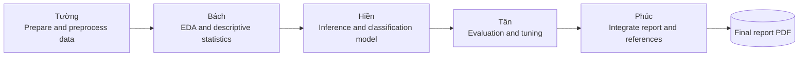

# Không gian làm việc và phân công nhóm

Mục tiêu là xây dựng một quy trình có thể tái lập để phân tích/phân loại `ad` và `nonad` trong phạm vi môn Xác suất thống kê. Mỗi người có code, output và phần report riêng; không ai chỉ làm phần văn bản.

| Người | Sở hữu kỹ thuật | Sở hữu trong report | Bàn giao chính | Deadline |
|---|---|---|---|---|
| Tường | Dữ liệu gốc, kiểm tra schema, tiền xử lý và data dictionary | `01_overview.tex`, `03_preprocessing.tex` | `data/processed/` và mô tả dữ liệu sạch | 02/11/2026
| Phúc | Khung LaTeX, citation, README và khả năng tái lập | `02_background.tex`, `08_references.tex`, bìa/format | Report compile được và bibliography thống nhất | 02/11/2026
| Bách | EDA, bảng và biểu đồ thống kê mô tả | `04_descriptive.tex`, bản nháp thảo luận | Bảng/hình mô tả kèm insight | 06/11/2026
| Hiền | Phương pháp suy diễn/phân loại chính | `05_inference.tex` (phương pháp và kết quả lần đầu) | Code train/predict, giả định và output mô hình | 11/11/2026
| Tân | Chia tập, đánh giá, so sánh/tối ưu và kiểm tra cuối | `05_inference.tex` (đánh giá), `06_discussion.tex`, `07_sources.tex` | Metric, phân tích lỗi, kiểm tra PDF–output | 14/11/2026

## Workflow trực quan

## Tường — Data setup và preprocessing

**Input:** file dataset nguyên gốc trong `data/raw/`.

**Làm:** ghi nguồn/tên file/ngày tải; không sửa file gốc; kiểm tra số dòng, cột, tên và kiểu biến, nhãn, missing/duplicate; chốt cách mã hoá nhãn và các bước làm sạch; xuất dataset chuẩn sang `data/processed/`; tạo data dictionary.

**Output:** `scripts/01_data_setup.R`, dữ liệu processed, bảng/metadata mô tả biến.

**Viết:** nguồn và bối cảnh data, đơn vị quan sát, nhãn `ad/nonad`, quy mô/biến; bảng “vấn đề → xử lý → lý do”. Không tự kết luận hiệu năng model.

## Phúc — Report platform, kiến thức nền và references

**Làm:** giữ `report/thesis.tex` compile được; duy trì heading, caption, label và citation; tạo `references.bib`; ghi cách chạy trong README; hợp nhất thay đổi kiến thức nền mỗi khi nhóm dùng kỹ thuật mới.

**Output:** khung report mà mọi người chỉ cần điền section của mình, hướng dẫn compile và tài liệu tham khảo chuẩn.

**Viết:** khái niệm/phương pháp thực sự đã dùng (không thêm lý thuyết ngoài phạm vi). Phúc không tự suy đoán phương pháp từ code của người khác.

## Bách — Thống kê mô tả và EDA

**Input:** chỉ dùng dataset processed của Tường.

**Làm:** mô tả tần số/tỷ lệ `ad`–`nonad`, phân bố biến, bảng/biểu đồ so sánh hai nhóm và các quan hệ sơ bộ phù hợp với dữ liệu.

**Output:** `scripts/02_eda_descriptive.R`, file bảng/hình tại `output/`, caption và nhận xét cho từng output.

**Viết:** phần thống kê mô tả và insight ban đầu; đồng thời gửi câu “phát hiện–ý nghĩa–giới hạn” cho phần thảo luận.

## Hiền — Suy diễn/phương pháp chính

**Input:** processed data của Tường và insight EDA của Bách.

**Làm:** chọn phương pháp phù hợp sau khi nhìn dữ liệu; phát biểu giả định, quy trình tính/train–predict và chạy phiên bản đầu. Ví dụ Bayes/Naive Bayes chỉ được dùng khi nhóm chốt là phù hợp, không phải phương pháp bị mặc định.

**Output:** `scripts/03_inference_model.R`, prediction/model output và giải thích công thức/phương pháp.

**Viết:** câu hỏi, dữ liệu/biến dùng, giả định, công thức/quy trình, kết quả đầu; không tự đánh giá là “tối ưu” trước khi Tân kiểm tra.

## Tân — Đánh giá, tối ưu và kiểm tra

**Input:** output từ Hiền; quy tắc chia dữ liệu phải được ghi rõ và tránh data leakage.

**Làm:** chốt train/validation/test; tính metric phù hợp, confusion matrix và so sánh các cấu hình/phương án đã chốt; phân tích lỗi; đối chiếu số trong report với output cuối.

**Output:** `scripts/04_evaluation.R`, bảng metric/so sánh, biểu đồ hoặc confusion matrix, checklist kiểm tra cuối.

**Viết:** cách đánh giá, kết quả cuối, giới hạn và hướng mở rộng; bổ sung link dữ liệu/code khi Tường/Phúc cung cấp thông tin.

## Quy tắc thêm phương pháp mới

Ai dùng thêm công thức, kiểm định, chỉ số hoặc cách xử lý mới phải cập nhật `METHODS_LOG.md` và báo Phúc trước khi ghép report. Gửi đủ: tên phương pháp, file code, mục đích, giải thích ngắn và nguồn tham khảo. Người dùng phương pháp chịu trách nhiệm tính đúng; Phúc chịu trách nhiệm để kiến thức nền, citation và format nhất quán.
